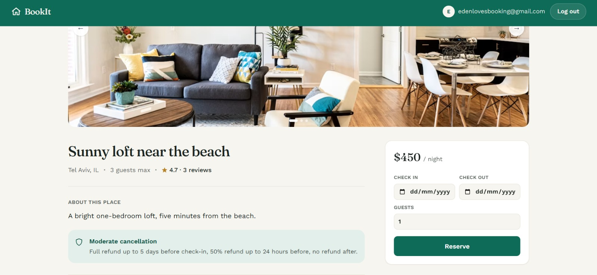
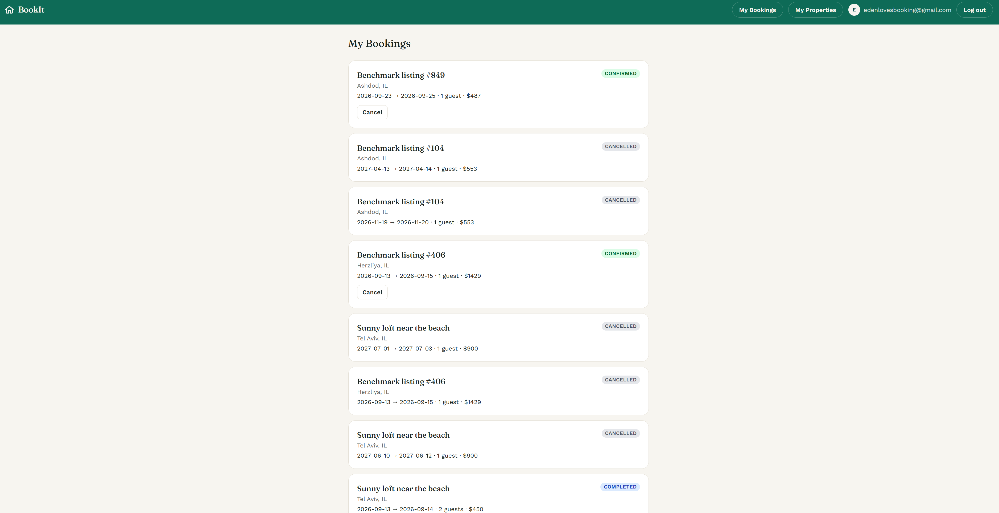

# BookIt

BookIt's backend is a Python/FastAPI modular monolith powering a vacation-rental booking platform: guests search, book, and pay for stays while hosts manage their own listings and reservations. A React frontend is included, but the focus here is backend architecture: payment orchestration, event-driven messaging, and concurrency control.

| Feed | Property detail | My Bookings |
|---|---|---|
|  |  |  |

## Highlights

- **Saga-based payment orchestration:** reservation confirmation is coordinated against an external payment call using idempotency keys, webhook-based async confirmation, and a scheduled Celery/RabbitMQ reconciliation worker as a fallback when webhook delivery fails.
- **Event-driven notifications:** the outbox pattern plus Kafka decouple reservation state changes from email delivery, so a slow or failing notification path can never block a booking.
- **Concurrency-safe booking:** a database-level exclusion constraint plus Redis distributed locks prevent double-booking under concurrent requests (load-tested).
- **JWT auth with refresh-token rotation**, async SQLAlchemy, and 80+ unit tests.

**Tech stack:** FastAPI · PostgreSQL · async SQLAlchemy · Redis · Kafka · Celery/RabbitMQ · React

See [app/README.md](app/README.md) for the code layout, or [docs/domain-layer/reservation-lifecycle.md](docs/domain-layer/reservation-lifecycle.md) for how a reservation actually moves end to end -- creation, background jobs, events, and where payment (Epic 8) will eventually plug in.

---

## Setup (first time on a machine)

1. Install [Docker Desktop](https://www.docker.com/products/docker-desktop/) — runs Postgres, Redis, RabbitMQ, Kafka, MailHog (and optionally the app, worker, beat, and notification-consumer)
2. Install [uv](https://docs.astral.sh/uv/getting-started/installation/) — manages the Python environment and dependencies:
   ```bash
   powershell -ExecutionPolicy ByPass -c "irm https://astral.sh/uv/install.ps1 | iex"
   ```
3. Clone the repo, then from its root:
   ```bash
   uv sync
   cp .env.example .env
   ```
   `uv sync` reads `pyproject.toml` + `uv.lock` and creates `.venv` with the exact dependency versions already locked — nothing to configure. `.env` is your local config (gitignored); the example file has working defaults for the Docker-based infra below.

That's it — you don't need to install Python packages globally, and you don't need to install Postgres/Redis/RabbitMQ/Kafka/MailHog natively at all. Everything else is `uv` (app + deps) and `docker compose` (infra), covered below.

## Seed data for local development

After a fresh `alembic upgrade head` (schema exists but every table is empty), run:

```bash
uv run python -m app.core.db.seed
```

This inserts a small set of realistic sample data — hosts, guests, properties, reservations (including one cancelled, so the `EXCLUDE` constraint's `WHERE status <> 'cancelled'` behavior is visible), payments, and reviews — so there's something to look at in DBeaver or call through the API without inserting rows by hand.

Safe to run again at any time — every seeded row has a fixed, hardcoded id, so re-running finds the existing rows and skips them instead of creating duplicates.

## Who runs what, and how

**The infrastructure (Postgres, Redis, RabbitMQ, Kafka, MailHog) always runs in Docker, in both workflows below — that never changes.** No native install of any of them, ever.

**What changes between the two workflows is where the app's own processes (`app`, `worker`, `beat`, `notification-consumer`) run** — directly on your machine, or also inside Docker as their own containers. In practice only `app` benefits from staying on the host (auto-reload); the other three are recommended in Docker either way, since none of them has a `--reload` to gain from the host. That choice is what determines how each process addresses the infrastructure:

- Running **inside Docker**, alongside the infra containers → reaches them by container/service name (`db`, `redis`) — Docker's internal network resolves those names, but only for containers on that same network
- Running **on your machine**, outside Docker → can't use those internal names at all. It has to go through the port each container *published* to your host machine — `localhost:5432`, `localhost:6379`, etc.

Same infrastructure, same containers — just two different vantage points for reaching them.

### Workflow A — active development (recommended day-to-day)

Infra, `worker`, `beat`, and `notification-consumer` in Docker; `app` on your machine with `uv`, for fast auto-reload on code changes without rebuilding a container each time.

```bash
docker compose up -d db redis rabbitmq kafka kafka-ui mailhog worker beat notification-consumer
uv run uvicorn app.main:app --reload
```

The app reads `.env` (see `.env.example`), which points at `localhost` — this works because docker-compose publishes each service's port to your host machine (`5432`, `6379`, `5672`, `9094` for Kafka, `1025`/`8025` for MailHog).

**MailHog** catches every email BookIt sends without delivering it anywhere — view them at [http://localhost:8025](http://localhost:8025). Two different senders, both land here: `worker` sends the reservation-received email directly (BOOK-45), and `notification-consumer` sends the confirmed/cancelled emails after consuming them from Kafka (BOOK-51). See `docs/jobs/email-basics.md`.

**Kafka** (BOOK-48) doesn't ship a web UI itself, unlike RabbitMQ — `kafka-ui` is a separate container added for exactly that, browsing topics/partitions/messages at [http://localhost:8090](http://localhost:8090). See `docs/jobs/kafka-basics.md`. The full publish → broker → consume pipeline for `booking-events` is traced end to end in `docs/jobs/booking-events-flow.md`.

**First time only — `kafka-data` volume permissions.** `rabbitmq`'s and `kafka`'s data now persist across restarts via named volumes (`rabbitmq-data`, `kafka-data`) instead of being wiped every `docker compose down`. RabbitMQ's image handles this itself, but Kafka's doesn't: a brand-new `kafka-data` volume is created owned by `root`, while the container runs as `appuser` (uid 1000) — Kafka fails to start (`Error while writing meta.properties file`) until that's fixed once:

```bash
docker run --rm -v bookit_kafka-data:/data alpine chown -R 1000:1000 /data
```

Only needed the first time the volume is created on a machine — already-running setups (or anyone who ran this once) never need it again.

For anything the UI doesn't cover, the CLI tools bundled in the Kafka container itself work too:

```bash
docker compose exec kafka /opt/kafka/bin/kafka-topics.sh --describe --bootstrap-server localhost:9092 --topic booking-events
docker compose exec kafka /opt/kafka/bin/kafka-console-consumer.sh --bootstrap-server localhost:9092 --topic booking-events --from-beginning
```

On Windows with Git Bash, prefix these with `MSYS_NO_PATHCONV=1` — Git Bash otherwise rewrites the `/opt/kafka/...` path as if it were a path on your own machine, before it ever reaches the container.

**Restarting `worker`/`beat`/`notification-consumer` after a change — two different commands depending on what changed:**

```bash
docker compose restart notification-consumer    # code-only change (e.g. notification/service.py)
docker compose up -d notification-consumer      # docker-compose.yml itself changed (env vars, command, ports)
```

`restart` re-runs the container's command against the same config it already has — since the code is bind-mounted, it does pick up edited `.py` files, but it does **not** re-read `docker-compose.yml`. `up -d` compares the running container against the compose file and recreates it if that file changed, which is the only way an updated environment variable (or similar) actually takes effect. Using `restart` after an `environment:` change silently keeps the old value — no error, it just doesn't apply.

### Workflow B — full stack in Docker (matches production)

Run everything, including the app, in containers. Useful for testing the actual `Dockerfile`, or verifying the app works the way it will in CI/production.

```bash
docker compose up --build   # starts every service: app, worker, beat, notification-consumer, and all infra
```

Here the `app` container does **not** use your local `.env` — [docker-compose.yml](docker-compose.yml) overrides `DATABASE_URL`/`REDIS_URL` with container hostnames (`db`, `redis`) instead of `localhost`, since containers reach each other by service name, not `localhost`.

### Why the difference matters

`localhost` means different things depending on where code is running: on your machine, it's your machine. Inside a container, it's *that container* — not the Postgres container next to it. So:
- App running **on your machine** → talks to infra via `localhost:<published-port>`
- App running **inside Docker** → talks to infra via the service name (`db`, `redis`), which Docker's internal network resolves for you

That's why there are two different sets of connection strings — `.env` for Workflow A, and the `environment:` block in `docker-compose.yml` for Workflow B — rather than one shared config.

## Frontend

A React + TypeScript SPA covering search, property details, booking, and booking management lives in `frontend/`. With the backend running (Workflow A or B above):

```bash
cd frontend
npm install
cp .env.example .env
npm run dev
```

Visit [http://localhost:5173](http://localhost:5173). See [frontend/README.md](frontend/README.md) for structure and design notes.

## Simulating a payment provider webhook (BOOK-55)

`scripts/simulate_provider_webhook.py` plays the part of a real payment provider calling
back later with a charge's result -- see `docs/payment/webhook-basics.md` and
`docs/payment/payment-decisions.md` §8. It's a real HTTP call against your actual running
app, signed the same way the real endpoint expects (`app/payment/webhook_auth.py`).

To try it: find (or create) a `Payment` row that's `PENDING` -- e.g. one whose charge was
forced to `TIMEOUT`, or crashed mid-call -- then:

```bash
uv run python scripts/simulate_provider_webhook.py <payment_id> success
```

(`failure` also works.) A `200 {"status":"ok"}` means the app accepted it -- the payment's
`status` and, if it was a `CHARGE`, the reservation's `status` update immediately, the same
way they would from a real provider's callback.
