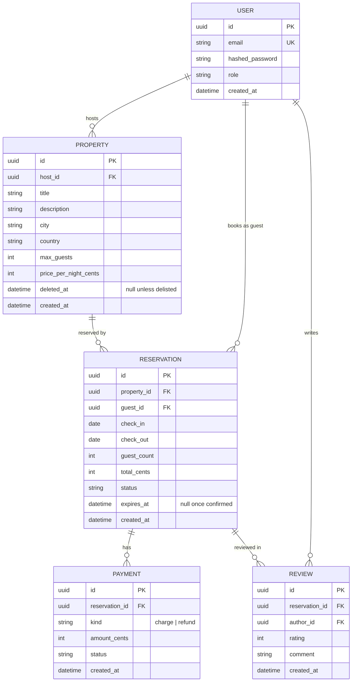

# ER Diagram — BookIt core domain

BookIt is a **short-term rental platform** (Airbnb-style): hosts list properties, guests book stays.



## In plain terms

- A **User** can host properties and book stays — same account, both actions.
- A **Property** is a place a host rents out: where it is, how many it sleeps, nightly price.
- A **Reservation** is one guest's stay at one property, `check_in` to `check_out`.
- A **Payment** is one attempt to move money for a reservation — a charge or a refund. A reservation has many, because cards decline and guests retry.
- A **Review** is written by one party about one stay. Author is the guest (reviewing the property) or the host (reviewing the guest) — same table, distinguished by `author_id`.

## Key constraints

- `User.email` is unique.
- `User.role` is `user | admin` — a permission tier for registered accounts only. An unauthenticated visitor isn't a `User` row at all, so "guest" always means the person on a reservation, never an auth state. Hosting and booking need no special role.

- **The big one (BOOK-24):** no two active reservations on the same property may overlap in dates.

  ```sql
  EXCLUDE USING gist (
      property_id WITH =,
      daterange(check_in, check_out, '[)') WITH &&
  ) WHERE (status <> 'cancelled')
  ```

  One database-level rule that makes double-booking physically impossible, even when two requests arrive at the same instant — an application-level "is it free?" check can't do that, because both requests can pass it before either writes. Cancelling frees the dates automatically (the `WHERE` clause drops cancelled rows out of the constraint).

- `CHECK (check_out > check_in)` — no zero-night or backwards stays.
- `CHECK (guest_count > 0)`; `guest_count <= property.max_guests` enforced in the service layer (cross-table, so not a column constraint).
- `Reservation.expires_at` — a `pending` reservation still holds its dates under the `EXCLUDE` constraint, so an abandoned checkout would block them forever. This gives Epic 6's expiry job something to filter on; it's cleared once the reservation is confirmed.
- **At most one successful charge per reservation:** partial unique index on `reservation_id WHERE kind = 'charge' AND status = 'succeeded'`. Failed and retried attempts still get their own rows — that history is what Epic 8's saga and idempotency work needs.
- `Review`: unique on `(reservation_id, author_id)` — each party reviews a stay once. `CHECK (rating BETWEEN 1 AND 5)`.
- `Property.deleted_at` — soft delete. A host delisting a property must not orphan or block its reservation history.
- `Reservation.status`: `pending → confirmed → cancelled → completed` (Epic 4).
- `Payment.status`: `pending → succeeded | failed` (Epic 8).
- Primary keys are UUIDs, not sequential integers — avoids leaking counts and enumeration through the API.
- Money is always integer **cents**, never floats.
- Dates are `date`, not `timestamp` — a stay is nightly, and timestamps invite timezone off-by-one-night bugs.
- `Reservation.total_cents` is a **snapshot** taken at booking time, not derived from `property.price_per_night_cents` at read time. If the host changes their price later, past reservations keep what the guest actually agreed to.

## Deliberately not modelled yet

Each of these is tracked — deferred, not forgotten. They're kept out of this diagram on purpose: it's the spec BOOK-22 builds from, so anything drawn here gets built now.

- **Photos** ([BOOK-74](https://edenbdv.atlassian.net/browse/BOOK-74)) — a listing site is photos-first in reality; adds a `PropertyPhoto` table, no impact on anything above.
- **Host-blocked dates** ([BOOK-75](https://edenbdv.atlassian.net/browse/BOOK-75)) — a property is currently bookable unless reserved. Letting hosts block dates (maintenance, personal use) is one more table using the same `EXCLUDE` technique.
- **Cancellation policies** ([BOOK-76](https://edenbdv.atlassian.net/browse/BOOK-76)) — refund amounts aren't policy-driven yet. Adds a `cancellation_policy` column to `Property` and uses the `refund` payment kind that already exists above.
- **A guest booking their own property** — a service-layer rule, not a schema constraint; belongs in [BOOK-34](https://edenbdv.atlassian.net/browse/BOOK-34).
