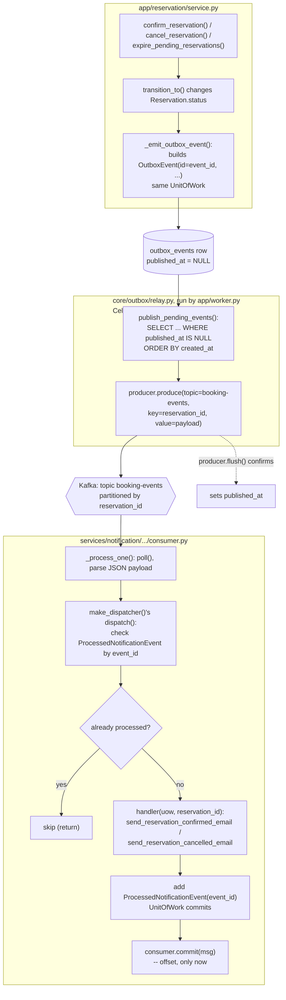

# The booking-events pipeline, end to end

One place tracing the concrete, current path of `BookingConfirmed`/`BookingCancelled`
through BookIt's actual code — publisher → broker → consumer. This page is *what
happens*, in order; for *why* each piece exists, follow the doc references in the table
below rather than looking for that reasoning repeated here. The two general patterns
underlying this pipeline each have their own concept doc, no BookIt specifics:
`outbox-basics.md` (the publisher side) and `inbox-basics.md` (the consumer side).



## Step by step

| # | Code | What happens | Why (doc reference) |
|---|---|---|---|
| 1 | `app/reservation/service.py` | A guest action or the expiry job transitions a reservation's status | `docs/domain-layer/state-machine-basics.md` |
| 2 | `_emit_outbox_event()` | An `OutboxEvent` row is written in the **same** `UnitOfWork` as the status change — `event_id` generated explicitly, not left to the column default | `outbox-basics.md` §3, `worker-decisions.md` §13 |
| 3 | `UnitOfWork.__aexit__` | Commits both the status change and the outbox row atomically, or neither | `docs/domain-layer/unit-of-work-basics.md` |
| 4 | (waiting) | The row sits with `published_at IS NULL` until the relay's next poll | `outbox-basics.md` §4 |
| 5 | `app/worker.py`'s `publish_outbox_events` (Celery beat, every 5s) → `relay.py`'s `publish_pending_events()` | Reads unpublished rows oldest-first, `producer.produce()`s each to `booking-events`, keyed on `reservation_id` | `worker-decisions.md` §11 |
| 6 | Kafka broker | Appends to the partition `reservation_id` hashes to — same-reservation events stay on one partition, in creation order | `kafka-basics.md` §3, `worker-decisions.md` §9 point 2 |
| 7 | `relay.py`, after `producer.flush()` | Only rows Kafka actually confirmed get `published_at` set — never set optimistically before that | `worker-decisions.md` §11 |
| 8 | `notification/consumer.py`'s `_process_one()` (`services/notification/src/`) (its own process, group `notifications`) | Polls, parses the JSON payload | `worker-decisions.md` §12 |
| 9 | `make_dispatcher()`'s `dispatch()` | Checks `ProcessedNotificationEvent` by `event_id`; already there → skip | `worker-decisions.md` §13 |
| 10 | `dispatch()` | Not yet processed → calls the matching email handler with `reservation_id` | `worker-decisions.md` §13 |
| 11 | `dispatch()`, after the handler returns | Marks `ProcessedNotificationEvent`, `UnitOfWork` commits | `worker-decisions.md` §13 |
| 12 | `_process_one()`, after `dispatch()` returns without raising | Commits the Kafka offset — only now, not on receipt | `worker-decisions.md` §12 |

## Worked example — one message, start to finish

The payload for a confirmed reservation, as `_emit_outbox_event()` writes it and as
the consumer reads it back off Kafka:

```json
{
  "event_id": "8f3a1c2e-5b4d-4e6f-9a1b-7c8d9e0f1a2b",
  "event_type": "booking_confirmed",
  "reservation_id": "1234abcd-5678-90ab-cdef-1234567890ab",
  "occurred_at": "2026-09-11T14:32:07.123456+00:00"
}
```

`make_dispatcher()`'s `dispatch()` (`notification/consumer.py`) runs once this
reaches `_process_one()`:

```python
event_id = uuid.UUID(payload["event_id"])          # UUID('8f3a1c2e-...')

async with UnitOfWork() as uow:
    already_processed = await uow.session.get(ProcessedNotificationEvent, event_id)
    # SELECT ... WHERE event_id = '8f3a1c2e-...'  -- first delivery: nothing found, None

    if already_processed is not None:
        return                                       # not taken this time

    handler = email_handlers[payload["event_type"]]  # send_reservation_confirmed_email
    await handler(uow, uuid.UUID(payload["reservation_id"]))
    # sends the actual email (fetches reservation/guest/property, SMTP via MailHog)

    uow.session.add(ProcessedNotificationEvent(event_id=event_id))
    # new row: event_id='8f3a1c2e-...', processed_at=now()

# `async with` exits -> UnitOfWork commits the marker row
```

**Redelivery of the exact same message** (e.g. the process crashed after the email sent
but before this commit, and the offset was therefore never committed either — §13's
accepted duplicate window): `uow.session.get(...)` now finds the row from the first
attempt, `already_processed` is not `None`, and `dispatch()` returns immediately —
`handler()` is not called again, no second email.

### Two separate commits, two different jobs

This flow has two commits, and they are not interchangeable:

| Commit | Says | What it actually protects |
|---|---|---|
| DB commit of `ProcessedNotificationEvent` (end of `dispatch()`'s `UnitOfWork`) | "I have actually performed this event's business action (sent the email)" | **Correctness.** This is the only thing standing between a redelivery and a duplicate email. |
| Kafka offset commit (`consumer.commit(msg)`, end of `_process_one()`) | "This consumer group doesn't need to see this message again" | **Efficiency.** If this never ran at all, every restart would redeliver everything since the last committed offset — wasteful (an Inbox lookup per message), but not incorrect, since the Inbox check would still catch every already-handled one. |

The precise boundary of the duplicate window follows from this: it's the gap between
the email actually sending and the **DB** commit succeeding — not the gap up to the
Kafka commit. A crash *after* the DB commit but *before* `consumer.commit(msg)` still
redelivers the message, but `dispatch()` finds the `ProcessedNotificationEvent` row on
that redelivery and returns immediately — no duplicate. The Kafka commit only avoids
that harmless-but-wasted redelivery; it does no part of the actual deduplication work.

## What this diagram assumes isn't built yet

- The `docker-compose.yml` service that actually runs `python -m notification` (`services/notification/src/notification/__main__.py`) as its own container, built from `services/notification/Dockerfile` (BOOK-64).

Everything else in this diagram — outbox writes, the relay, both email handlers, and
the entrypoint that wires them into the consumer loop — is built today. The only thing
missing is something to run it continuously outside a developer's own terminal.
