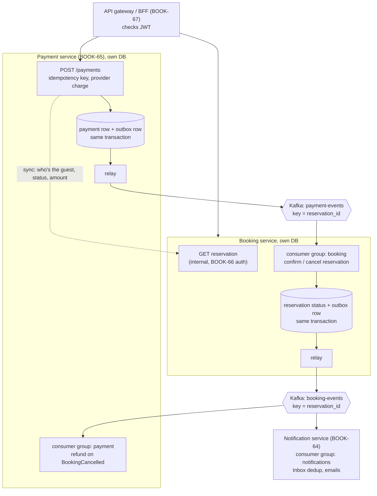

# Epic 11: the target event flow (proposal)

**Status: design proposal, nothing here is built yet.** This page sketches how the
payment and booking-events flows change once Payment (BOOK-65) and Notification
(BOOK-64) become their own services. For today's in-process flow, see
`docs/jobs/booking-events-flow.md` and `docs/payment/saga-basics.md`; for why Kafka
was kept with only one consumer, see `docs/jobs/worker-decisions.md` §14. New to
microservices? Start with `microservices-basics.md` — the theory and the
ticket-by-ticket plan this page assumes.

## Today vs. Epic 11

| | Today (Epics 7–8) | Epic 11 |
|---|---|---|
| Payment → reservation | Direct call: `saga.react_to_payment_outcome()` calls `confirm_reservation()` / `cancel_reservation_system()` | `PaymentSucceeded` / `PaymentFailed` on `payment-events`, consumed by Booking |
| Refund on guest/host cancel | Direct call in `payment/cancellation.py` | Payment consumes `BookingCancelled` from `booking-events` |
| Kafka producers | 1 (reservation outbox) | 2 (Booking outbox, Payment outbox) |
| Kafka consumer groups | 1 (`notifications`) | 3 (`notifications`, `booking`, `payment`) |
| Payment reads reservation | Same DB, same `UnitOfWork` | Sync REST/gRPC call to Booking (BOOK-66 auth) |

## The flow

## Step by step: a guest pays

1. Guest calls `POST /payments`. The gateway validates the JWT and routes to Payment.
2. Payment calls Booking **synchronously** to read the reservation (guest id, status,
   `total_cents`). Sync because the guest is waiting on the response; this is the one
   cross-service call that isn't an event.
3. Payment charges the provider, then writes the payment row **and** a
   `PaymentSucceeded` / `PaymentFailed` outbox row in one transaction. Its relay
   publishes to `payment-events`, keyed by `reservation_id`.
4. Booking's `booking` consumer group reads `payment-events`:
   - `PaymentSucceeded` → `confirm_reservation()` → `BookingConfirmed`
   - `PaymentFailed` → `cancel_reservation_system()` → `BookingCancelled`

   Both go through Booking's existing outbox to `booking-events`, unchanged from today.
5. Notification consumes `booking-events` and sends the email, same as today, just
   running as its own service.
6. Payment's `payment` consumer group also reads `booking-events`. On a
   `BookingCancelled` for a reservation with a succeeded charge, it issues the refund.
   This is the first real fan-out: two independent groups on one topic.

`PENDING` (provider timeout) keeps working as today: no event is published until the
webhook or `reconcile_stale_payments` resolves the payment, and only then does the
outcome event go out.

## Open design points

- **Refund amount.** The policy-based refund (`calculate_refund_cents`) needs the
  property's `cancellation_policy`, which lives in Booking. Either `BookingCancelled`
  carries `refund_cents` (and who cancelled: guest / host / system), or Payment calls
  Booking for it. Leaning towards putting it in the event: the consumer stays
  self-contained.
- **Don't refund what was never charged.** `BookingCancelled` also fires for
  `PaymentFailed` and for expired unpaid reservations. Payment's consumer must check
  for a succeeded charge first, the same check `cancellation.py` does today.
- **Charge succeeded, confirm failed.** Today `_refund_and_release()` handles this
  in-process. In Epic 11, Booking publishes something like `BookingConfirmationFailed`
  and Payment refunds on it: the saga over the network (BOOK-68).
- **Every new consumer needs an Inbox.** Both relays are at-least-once, so the
  `booking` and `payment` consumer groups need the same `event_id` dedup the
  `notifications` group already has (`worker-decisions.md` §13). A duplicate refund is
  far worse than a duplicate email.
- **Ordering.** Per-reservation order holds *within* each topic (keyed by
  `reservation_id`), not *across* `payment-events` and `booking-events`. That's fine
  here: each topic has a single producer, and the cross-topic sequence is driven by
  cause and effect (Booking only emits after consuming the payment event).

## Where each piece lands

| Ticket | What it covers on this page |
|---|---|
| BOOK-64 | Notification as its own service (consumer side unchanged) |
| BOOK-65 | Payment service, its outbox, `payment-events` |
| BOOK-66 | Auth on the sync Payment → Booking call |
| BOOK-67 | The gateway in front |
| BOOK-68 | Booking consumes `payment-events`; compensation over the network |
